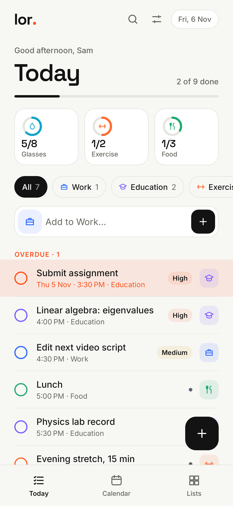
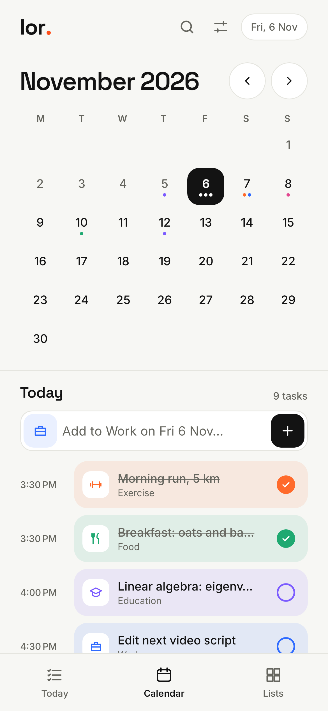
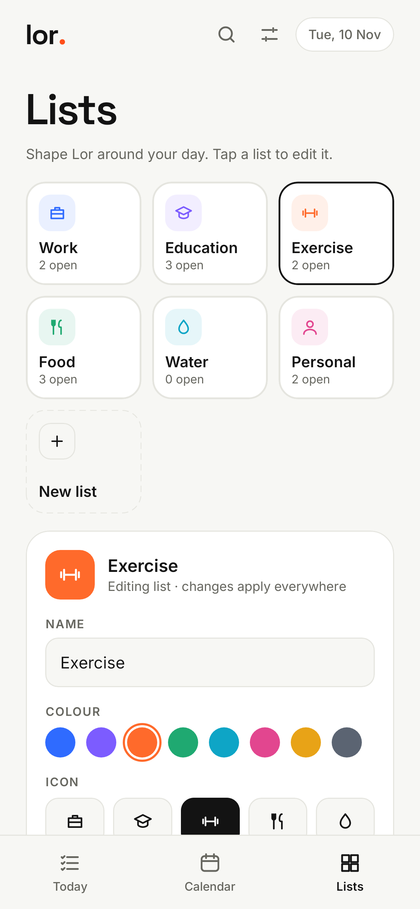
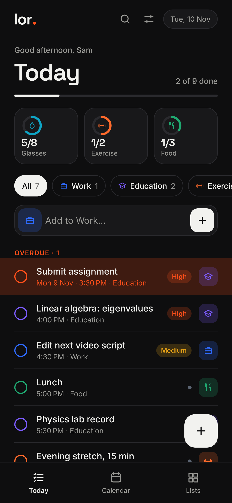
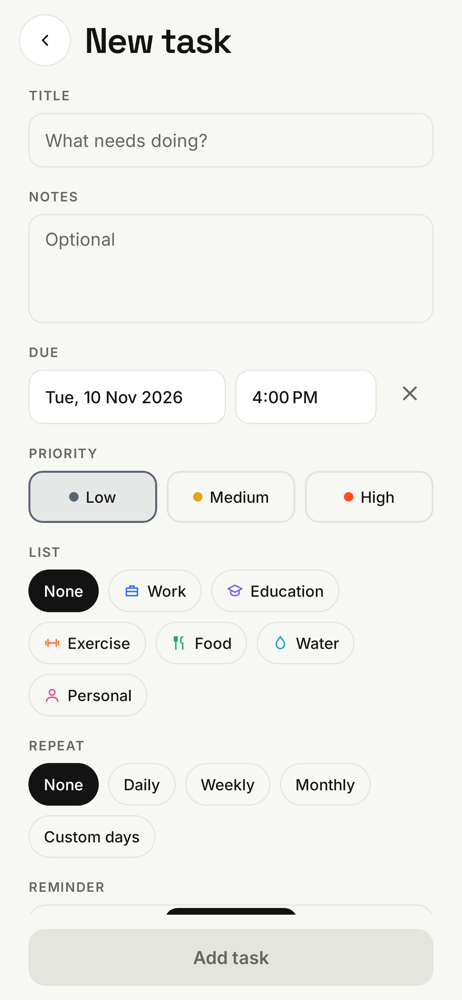
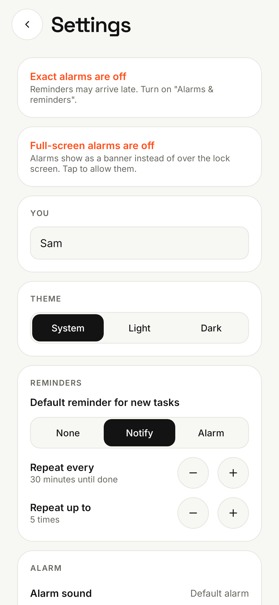

<p align="center">
  
</p>

<h1 align="center">LOR</h1>

<p align="center">
  A to-do app that stays on your phone and won't let you forget.<br>
  No account, no cloud, no internet permission: every task lives on your device and nowhere else.
</p>

<p align="center">
  <a href="https://github.com/mecrimino/lor/releases/latest/download/lor.apk"><b>Download the APK</b></a>
  &nbsp;·&nbsp;
  <a href="https://mecrimino.github.io/lor-todo-website/">Website</a>
  &nbsp;·&nbsp;
  <a href="https://github.com/mecrimino/lor/releases">All releases</a>
</p>

## Install

1. [Download `lor.apk`](https://github.com/mecrimino/lor/releases/latest/download/lor.apk) on your Android phone (Android 8.0 or newer).
2. Open the file. If Android asks, allow your browser or file manager to install apps.
3. If Google Play Protect warns about an unknown developer, choose **Install anyway**. LOR isn't on the Play Store, so Android doesn't recognise the developer.

## Features

- **Today at a glance**: greeting, progress, overdue tasks highlighted, what's next, quick-add bar
- **Tasks**: notes, due date and time, Low/Medium/High priority, lists, subtasks
- **Repeats**: daily, weekly, monthly or chosen days of the week
- **Reminders that work**: exact notifications with Done and Snooze buttons, or a full-screen alarm that rings over the lock screen
- **Nudges**: keeps reminding you at an interval you choose until the task is done (default every 30 minutes, 5 times)
- **Daily summary**: optional morning and evening notifications at times you pick
- **Calendar, search, filters and sorting**
- **Water tracker and daily rings**
- **Completed history and stats**: this week's count and your current streak
- **Home screen widget** with checkboxes
- **JSON backup and restore** to any location you choose
- **Light, dark and system themes**

Alarms are re-armed after a reboot, an app update or a time zone change.

## Screenshots

| Today | Calendar | Lists |
| --- | --- | --- |
|  |  |  |

| Dark theme | New task | Settings |
| --- | --- | --- |
|  |  |  |

These are rendered from the real Compose screens on the JVM. To regenerate them into `app/build/screens/`:

```bash
./gradlew testDebugUnitTest --tests '*ScreenshotTest*'
```

## Build

You need JDK 17 or newer and the Android SDK with platform 37.

```bash
./gradlew assembleDebug
```

The APK appears in `app/build/outputs/apk/debug/`. For a release build:

```bash
./gradlew assembleRelease
```

This produces an unsigned APK, as F-Droid expects; sign it with your own key to install it directly.

## Tests

JVM tests (no device needed) cover the reminder rules, repository, ViewModels and backup, using Robolectric with an in-memory database and the real AlarmManager scheduling code:

```bash
./gradlew testDebugUnitTest
```

Room DAO tests run on a device or emulator:

```bash
./gradlew connectedDebugAndroidTest
```

## Project layout

```
app/src/main/java/io/github/mecrimino/lor/
  data/        Room entities and DAO, DataStore settings, repository, backup, reminder and repeat rules
  di/          Hilt module
  reminders/   AlarmManager scheduling, notifications, alarm service, broadcast receivers
  ui/          Compose screens, one package per screen, plus theme and shared components
  widget/      Glance home screen widget
```

## Permissions

See [PERMISSIONS.md](PERMISSIONS.md). There is no `INTERNET` permission, and `ManifestTest` fails the build's tests if one ever appears.

## Reliable alarms on your phone

Some manufacturers (Xiaomi, Oppo, Vivo, Realme and others) stop background alarms to save battery. LOR shows a one-time tip for this; you can also turn off battery optimisation for LOR in system settings.

## License

LOR is free software under the [GNU General Public License v3.0](LICENSE).

It bundles the [Inter](https://github.com/rsms/inter) and [Space Grotesk](https://github.com/floriankarsten/space-grotesk) typefaces under the SIL Open Font License 1.1; see [licenses/](licenses/).
